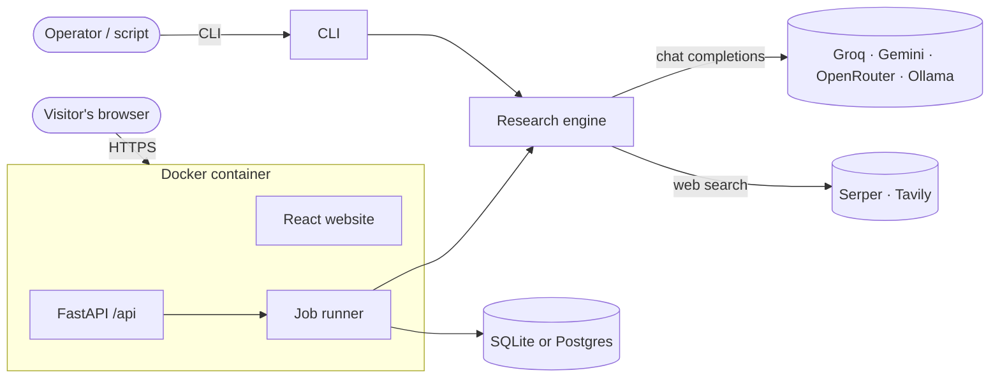
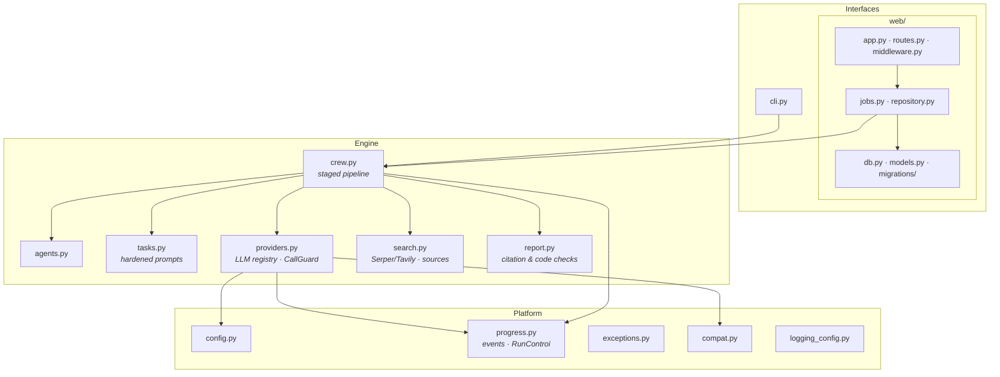
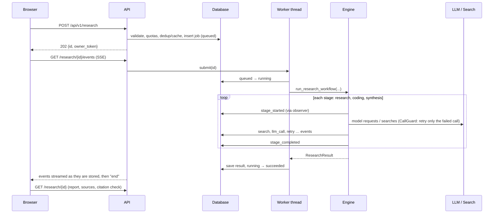
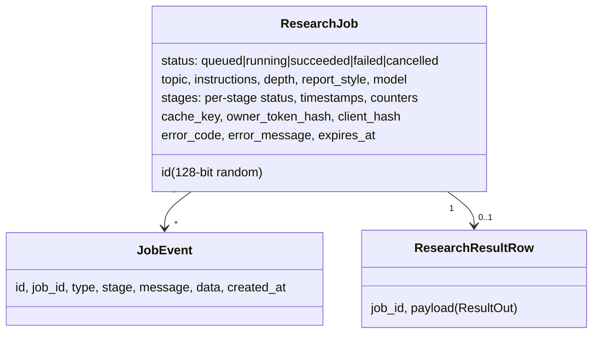

# Architecture (High-Level Design)

This document describes the high-level design of the Multi-Agent Research Team
platform: its components, runtime flow, key design decisions, and extension
points. Decision rationale is recorded in
[IMPLEMENTATION_PLAN.md](IMPLEMENTATION_PLAN.md).

## 1. System context

The **research engine** is a reusable Python library. The **CLI** and the **web
app** are two thin interfaces over the same entry point,
`run_research_workflow(topic, config, options, on_progress=..., control=...)`,
which returns a structured `ResearchResult`.

## 2. Component view

Dependency direction is strict: interfaces → engine → platform. The engine
never imports the web layer.

| Module | Responsibility |
| --- | --- |
| `crew.py` | Runs research → coding → synthesis as separate stages; provider fallback per stage; assembles `ResearchResult`. |
| `providers.py` | Provider registry (all via LiteLLM, explicit credentials); `CallGuard` retries one request with backoff + jitter, honours `Retry-After`, checks cancellation. |
| `search.py` | Search providers with fallback; untrusted-data framing; search budget; `SourceCollector` of every retrieved result. |
| `report.py` | Citation-marker normalisation, link-vs-source check, Python syntax check, size limit, methodology and sources sections. |
| `progress.py` | `ProgressEvent` types and `RunControl` (cancellation + deadline). |
| `tasks.py` / `agents.py` | Prompts with delimited user data; agents without delegation, code execution, or task-level retries. |
| `web/jobs.py` | Persist-then-execute job runner, bounded thread pool, restart recovery, cancellation, janitor. |
| `web/routes.py` | REST + SSE endpoints, validation, quotas, caching, idempotency. |
| `web/middleware.py` | Request IDs, security headers/CSP, body limit, per-IP rate limit (pure ASGI). |

## 3. Runtime flow of one research job

**Failure handling.** A transient error retries one request. If a provider stays
rate-limited or unavailable, the current stage restarts on the next configured
fallback provider; completed stages are never repeated. Cancellation and the
time budget are checked before every model request and search.

## 4. Key data structures

`AppConfig` (engine) and `WebSettings` (server) are frozen, validated
dataclasses built from environment variables.

## 5. Cross-cutting concerns

* **Resilience** — per-call retries, per-stage provider fallback, bounded
  queues, timeouts, restart recovery, graceful shutdown (running jobs recorded
  as `interrupted`).
* **Security & abuse protection** — see [SECURITY.md](SECURITY.md).
* **Observability** — structured logs under the `research_team` logger
  namespace (stderr), request ids, readiness checks that probe the LLM provider
  cheaply (model list) and confirm the configured model is still served.
* **Performance** — heavy imports are lazy; CrewAI runs in worker threads, never
  on the event loop; the SSE endpoint is async and polls the database once per
  second; finished jobs expire.
* **Privacy** — salted IP hashes only; telemetry disabled.

## 6. Extensibility

* **Another LLM provider** — add it to `providers.provider_spec` (anything
  LiteLLM supports).
* **Another search provider** — implement `SearchProvider.search()` in `search.py`.
* **Another agent/stage** — add a factory in `agents.py`/`tasks.py`, a `Stage`
  member in `progress.py`, and a call in `ResearchPipeline.run`; the UI picks up
  stages from the API.
* **Scale out** — move `JobManager._execute` into a separate worker process that
  polls `queued` jobs (the database already holds all state), then run several
  API instances behind a load balancer (move the in-memory API rate limiter to a
  shared store at that point).

## 7. Known constraints

* **Free-tier quotas** bound throughput (Groq: 8K tokens/minute per model);
  see [FREE_TIER_INFRASTRUCTURE.md](FREE_TIER_INFRASTRUCTURE.md).
* **Single instance.** The API rate limiter and concurrency caps are in-memory;
  job quotas are in the database.
* **Sequential by design.** Stages run in order so each can build on the
  previous one; parallel stages are a possible future mode.
