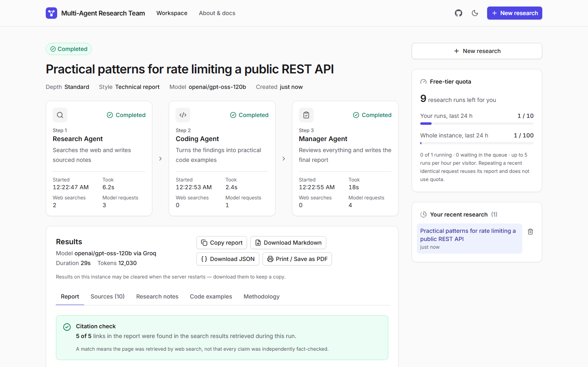
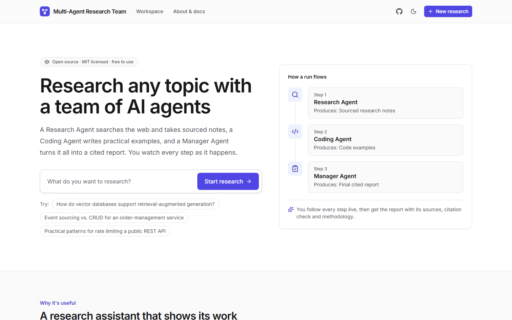
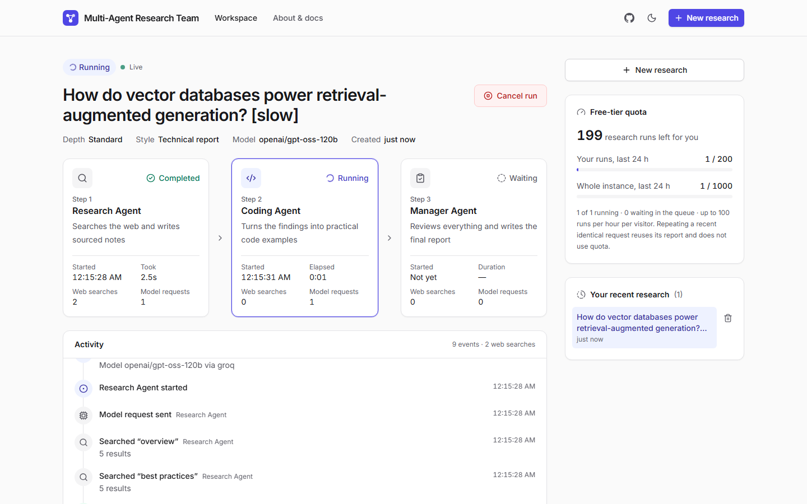
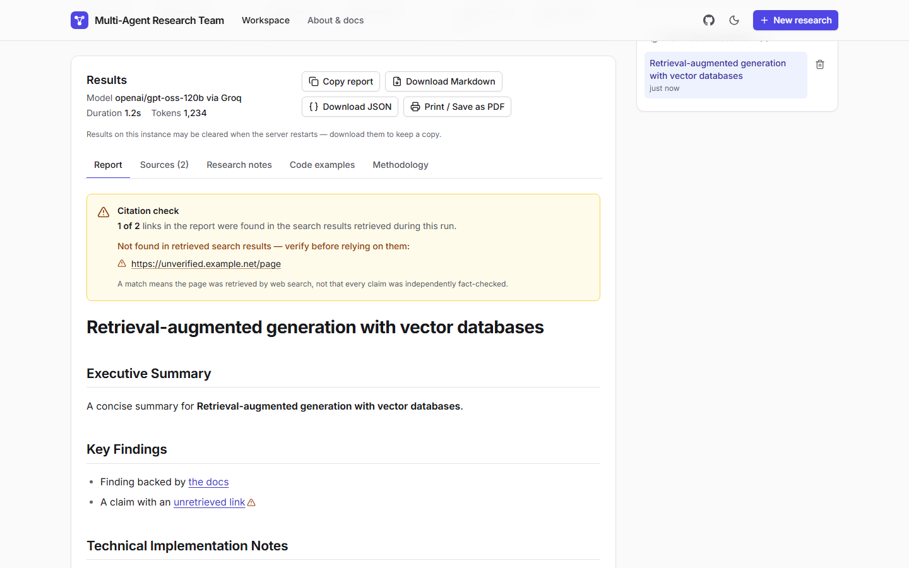
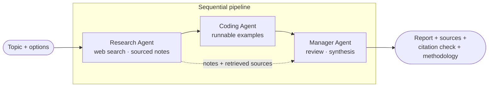

# Multi-Agent Research Team

[](https://github.com/syed-waleed-ahmed/Multi-Agent-Research-Team/actions/workflows/ci.yml)
[](https://www.python.org/)
[](LICENSE)
[](https://github.com/astral-sh/ruff)
[](https://mypy-lang.org/)

An open-source AI research platform. Give it a topic and a team of three AI
agents researches the web, writes practical code examples, and delivers a
cited, structured Markdown report — while you watch each agent work in real
time.

It runs as a **web app** (FastAPI + React) and as a **CLI**, built with
[CrewAI](https://github.com/crewAIInc/crewAI), [Groq](https://console.groq.com/),
and [Serper](https://serper.dev/). Every required service has a free tier with
no credit card.

```bash
multi-agent-research-team --topic "How to choose a vector database for RAG"
```

> **Live demo:** not deployed yet. Everything needed to deploy for free is in
> [DEPLOYMENT.md](DEPLOYMENT.md); a URL will be added here once a deployment is
> live and verified.

## Contents

- [Features](#features)
- [Screenshots](#screenshots)
- [How it works](#how-it-works)
- [Architecture](#architecture)
- [Technology stack](#technology-stack)
- [Quick start](#quick-start)
- [Configuration](#configuration)
- [Using the CLI](#using-the-cli)
- [Using the API](#using-the-api)
- [Deployment](#deployment)
- [Free-tier limits](#free-tier-limits)
- [Testing](#testing)
- [Project structure](#project-structure)
- [Contributing](#contributing) · [Security](#security) · [License](#license)

## Features

- **Three cooperating agents** — a Research Agent (web search, sourced notes), a
  Coding Agent (runnable examples) and a Manager Agent (review and synthesis).
- **Live agent monitoring** — every status change, search query, model request,
  retry and provider fallback is streamed from the backend over Server-Sent
  Events. Nothing is simulated.
- **Honest sourcing** — every link in a report is checked against the URLs the
  search tool actually retrieved; links that were not retrieved are flagged.
  Sources are labelled as search results, never as "verified".
- **Practical output** — technical report, executive brief or tutorial styles;
  research notes and code examples shown separately; Python blocks are
  syntax-checked (never executed); a factual methodology section.
- **Downloads** — Markdown, JSON, and print / save as PDF; copy to clipboard.
- **Built for free tiers** — per-call retries with backoff and jitter (honouring
  `Retry-After`), per-stage provider fallback, result caching, per-IP and global
  quotas, a bounded queue, and clear messages when a limit is reached.
- **Production engineering** — persisted jobs with restart recovery,
  cancellation, migrations (SQLite or Postgres), readiness probes, CSP and
  security headers, rate limiting, typed code, and a CI pipeline with unit,
  integration and end-to-end tests.

## Screenshots

A **real run** (Groq `openai/gpt-oss-120b` + Serper, 2026-11-16): three agents,
10 sources retrieved, 5 of 5 report links matched to retrieved sources, 29 s,
~12K tokens.



The images below come from the **deterministic test engine** used by the
end-to-end tests, so their content is sample output:

| Landing page | Live agent monitoring | Report with a flagged link |
| --- | --- | --- |
|  |  |  |

## How it works



1. **Research.** The Research Agent searches the web (2–6 queries depending on
   depth) and writes notes that cite their sources. Search results are treated
   as untrusted data.
2. **Code.** The Coding Agent turns the notes into short, runnable examples with
   setup instructions.
3. **Synthesis.** The Manager Agent reviews both, drops unsupported claims, and
   writes the final report, citing only URLs that were actually retrieved.
4. **Checks.** The engine compares the report's links with the retrieved
   sources, syntax-checks Python code, and appends the sources and a factual
   methodology.

## Architecture

```text
Browser ─▶ React website ─▶ FastAPI (/api/v1, SSE) ─▶ Job runner (threads) ─▶ Research engine
                                    │                         │                  ├─ Groq / fallbacks (LiteLLM)
                                    └─ security middleware     └─ SQLite/Postgres └─ Serper / Tavily
CLI ───────────────────────────────────────────────────────────────────────────▶ Research engine
```

The research engine is a reusable library with one entry point,
`run_research_workflow(topic, config, options)`. The CLI and the web app are
thin interfaces over it. See [ARCHITECTURE.md](ARCHITECTURE.md) for component
and sequence diagrams, and [IMPLEMENTATION_PLAN.md](IMPLEMENTATION_PLAN.md) for
the design decisions.

## Technology stack

| Layer | Technology |
| --- | --- |
| Agents | CrewAI 1.x, LiteLLM |
| LLM | Groq `openai/gpt-oss-120b` (default); Gemini, OpenRouter, Ollama, OpenAI-compatible as fallbacks |
| Web search | Serper (Google results), Tavily fallback |
| Backend | Python 3.10+, FastAPI, Uvicorn, SQLAlchemy 2, Alembic, SQLite / PostgreSQL (pg8000) |
| Frontend | React 19, TypeScript, Vite, Tailwind CSS 4, react-router, react-markdown, lucide icons |
| Quality | pytest, Ruff, mypy, Vitest, ESLint, Playwright, pip-audit, npm audit |
| Delivery | Docker, Render Free blueprint, GitHub Actions |

## Quick start

Requirements: Python 3.10+ (3.11+ recommended), Node 22+, a free
[Groq API key](https://console.groq.com/keys) and a free
[Serper API key](https://serper.dev).

```bash
git clone https://github.com/syed-waleed-ahmed/Multi-Agent-Research-Team.git
cd Multi-Agent-Research-Team

python -m venv .venv
source .venv/bin/activate            # Windows: .venv\Scripts\activate
pip install -e ".[web]"

cp .env.example .env                 # then add GROQ_API_KEY and SERPER_API_KEY

cd frontend && npm ci && npm run build && cd ..
research-team-web                    # open http://localhost:8000
```

CLI only? `pip install -e .` is enough (no Node needed).

> **Upgrading from 1.x?** Groq retired `llama-3.3-70b-versatile`. If your `.env`
> contains `GROQ_MODEL=llama-3.3-70b-versatile`, change it to
> `openai/gpt-oss-120b` (or delete the line).

## Configuration

All settings come from environment variables (or `.env`). The essentials:

| Variable | Required | Default | Description |
| --- | --- | --- | --- |
| `GROQ_API_KEY` | yes* | | Groq API key (*unless another `LLM_PROVIDER` is used) |
| `SERPER_API_KEY` | yes* | | Serper key (*or `TAVILY_API_KEY`) |
| `GROQ_MODEL` | no | `openai/gpt-oss-120b` | Groq model id |
| `GROQ_MAX_TOKENS` / `SYNTHESIS_MAX_TOKENS` | no | `2048` / `3072` | Output budgets (agents / final report) |
| `GROQ_MAX_RETRIES` | no | `3` | Retries for a single failed model request |
| `REASONING_EFFORT` | no | `low` | Reasoning budget for reasoning models |
| `LLM_PROVIDER` / `LLM_FALLBACK_PROVIDERS` | no | `groq` / – | Primary provider and ordered fallbacks |
| `TAVILY_API_KEY` | no | | Fallback web search |
| `DATABASE_URL` | no | SQLite file | Postgres URL for persistence (e.g. Neon) |
| `LOG_LEVEL` | no | `INFO` | Logging level |

Abuse-protection limits (`JOBS_PER_IP_PER_DAY`, `GLOBAL_JOBS_PER_DAY`,
`MAX_CONCURRENT_JOBS`, …), CORS, proxy and timeout settings are documented in
[`.env.example`](.env.example).

## Using the CLI

```bash
multi-agent-research-team --topic "Async Python patterns" --depth quick
multi-agent-research-team --topic "Vector databases for RAG" --style executive_brief -o reports/rag.md
multi-agent-research-team --topic "..." --model openai/gpt-oss-20b --temperature 0.4
python -m research_team --topic "..."        # same thing
```

The report goes to **stdout**; progress, logs and errors go to **stderr**, so
`... --quiet > report.md` captures only the report. `-o` saves the full
document (report, retrieved sources, methodology).

| Flag | Description |
| --- | --- |
| `--topic` | Required. Research topic or question. |
| `--depth` | `quick` (2 searches), `standard` (4), `deep` (6). |
| `--style` | `technical_report`, `executive_brief`, `tutorial`. |
| `--instructions` | Extra guidance, e.g. audience or focus. |
| `-o, --output` | Save the full Markdown document to a file. |
| `--provider`, `--model` | LLM provider and model. |
| `--temperature`, `--max-tokens`, `--max-rpm`, `--max-retries` | Model tuning. |
| `--timeout`, `--workflow-timeout` | Per-agent and whole-run time limits (seconds). |
| `-v`, `-q`, `--log-level` | Verbosity. |
| `--version` | Print the version. |

Exit codes: `0` success · `1` workflow failure (rate limit, cancellation,
timeout) · `2` configuration error · `3` missing dependency · `130` interrupted.

## Using the API

The web app exposes a versioned REST API with interactive docs at
**`/api/docs`**. Full reference: [docs/API.md](docs/API.md).

```bash
# submit
curl -s -X POST localhost:8000/api/v1/research -H 'Content-Type: application/json' \
     -d '{"topic": "How to choose a vector database for RAG", "depth": "quick"}'
# follow live progress
curl -N localhost:8000/api/v1/research/<id>/events
# fetch the result / download
curl -s localhost:8000/api/v1/research/<id>/result
curl -OJ "localhost:8000/api/v1/research/<id>/download?format=md"
```

## Deployment

One Docker image serves the website and the API. The repository includes a
[Render](https://render.com) Free blueprint ([`render.yaml`](render.yaml)) and
supports an optional free [Neon](https://neon.tech) Postgres database for
persistence. Step-by-step instructions, the verification checklist and
alternatives are in [DEPLOYMENT.md](DEPLOYMENT.md).

```bash
docker build -t multi-agent-research-team .
docker run --rm -p 8000:8000 --env-file .env multi-agent-research-team
```

## Free-tier limits

Free is not unlimited. Verified on 2026-11-15 (details and sources in
[FREE_TIER_INFRASTRUCTURE.md](FREE_TIER_INFRASTRUCTURE.md)):

- **Groq** (measured): 1,000 requests/day and 8,000 tokens/minute per model. A
  run uses ~10–12K tokens, so rate-limit pauses during a run are normal and
  handled automatically.
- **Serper**: 2,500 free searches at signup (each run uses 2–6).
- **Render Free**: sleeps after 15 minutes idle (first request takes ~1 minute),
  750 instance hours/month, ephemeral disk — use Neon to keep results.
- The shipped limits (10 runs per visitor per day, 60 per day in total, one run
  at a time) keep a public demo within these quotas. This is a portfolio-scale
  service, not a high-traffic one.

## Testing

```bash
pytest                            # backend: unit + integration (no network, no keys)
cd frontend && npm run test       # frontend unit/component tests
cd frontend && npm run test:e2e   # Playwright end-to-end journey
```

The backend suite drives **real CrewAI agents** with scripted LiteLLM responses,
runs the web API against an in-memory database, and covers retries, fallbacks,
cancellation, quotas, restart recovery and security headers. End-to-end tests
run the real API with a deterministic test engine. CI also runs Ruff, mypy,
ESLint, TypeScript checks, dependency audits, and a Docker build smoke test.

## Project structure

```text
├── src/research_team/
│   ├── cli.py              # CLI
│   ├── crew.py             # staged three-agent pipeline
│   ├── agents.py, tasks.py # agent factories, hardened prompts
│   ├── providers.py        # LLM providers, per-call retries (CallGuard)
│   ├── search.py           # Serper/Tavily, source collection, search tool
│   ├── report.py           # citation and code checks, methodology
│   ├── progress.py         # progress events, cancellation, deadlines
│   ├── config.py, exceptions.py, logging_config.py, compat.py
│   └── web/                # FastAPI app, routes, jobs, DB, migrations, security
├── frontend/               # React + TypeScript website
├── tests/                  # backend tests; tests/e2e/server.py (E2E test server)
├── docs/                   # API reference, screenshots
├── Dockerfile, render.yaml # deployment
├── constraints/security.txt
└── ARCHITECTURE.md, DEPLOYMENT.md, FREE_TIER_INFRASTRUCTURE.md, IMPLEMENTATION_PLAN.md, …
```

## Contributing

Contributions are welcome. See [CONTRIBUTING.md](CONTRIBUTING.md) for setup,
quality gates and the pull-request workflow. This project follows a
[Code of Conduct](CODE_OF_CONDUCT.md); changes are recorded in
[CHANGELOG.md](CHANGELOG.md).

## Security

Credentials belong in a git-ignored `.env` file or your host's secret store and
must never be committed. The threat model, controls and dependency advisories
are documented in the [security policy](SECURITY.md), which also explains how
to report a vulnerability.

## License

Released under the [MIT License](LICENSE).

Created by Syed Waleed Ahmed.
